# LNMIIT Heritage

An interactive heritage portal and satellite-aligned 3D campus explorer for The LNM Institute of Information Technology (LNMIIT), Jaipur.

**Status: prototype.** This is a student project, not an official LNMIIT website or admissions service.

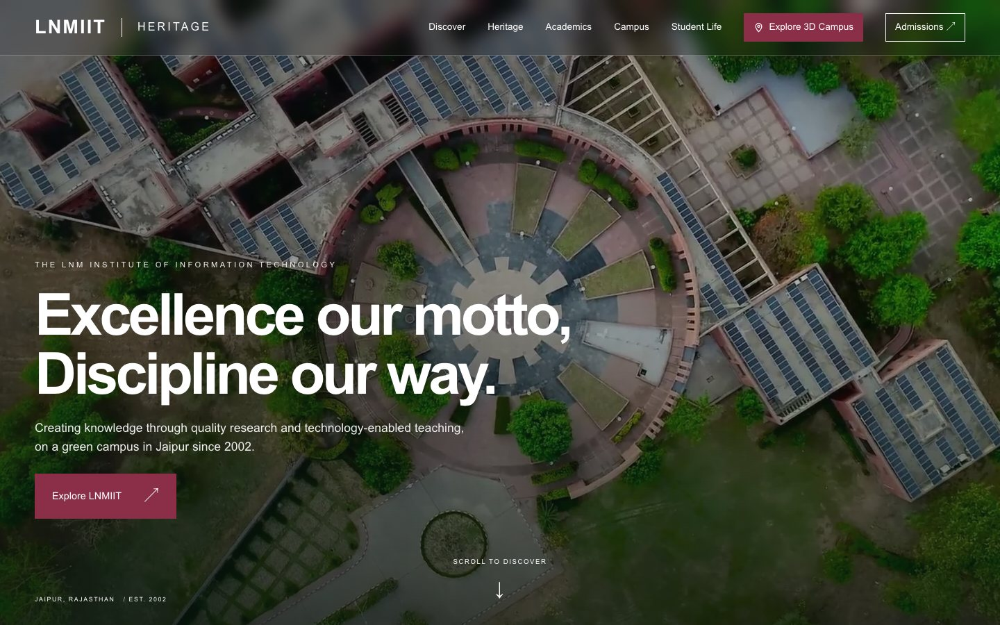

**Run it in three commands.** You need Node.js 22.13 or newer and pnpm 11.25.0. No database, backend, API key or `.env` file is required.

```bash
pnpm install --frozen-lockfile
pnpm run dev
# open http://localhost:3000
```

## Contents

- [Project overview](#project-overview)
- [Key features](#key-features)
- [Screenshots](#screenshots)
- [Technology stack](#technology-stack)
- [Architecture](#architecture)
- [Installation and setup](#installation-and-setup)
- [Environment variables](#environment-variables)
- [Database](#database)
- [API](#api)
- [Testing and verification](#testing-and-verification)
- [Known limitations](#known-limitations)
- [Future scope](#future-scope)
- [Team, contributing and licence](#team-contributing-and-licence)

## Project overview

**Purpose.** LNMIIT's history, academic departments, campus and student activity are spread across many separate pages and sites. This project brings them together in one place that visitors can explore, with the campus itself as the way in.

**Problem it addresses.** A prospective student or visitor cannot easily get a sense of the campus, what its student community does, or how the institute developed, without already knowing where to look.

**Target users.** Prospective students and parents, visitors, alumni, current students and researchers.

**Content policy.** Institutional facts are paraphrased from official LNMIIT pages and mapped to their sources in [SOURCES.md](SOURCES.md). The content is a reviewed snapshot, not a live feed. Fees, dates, seats and placement figures are left out on purpose and link to official pages instead.

## Key features

These are implemented in this repository. See [docs/PROJECT_STATUS.md](docs/PROJECT_STATUS.md) for what is partial or planned.

| Module | Route | What it does |
| --- | --- | --- |
| Homepage | `/` | Campus hero, vertical heritage timeline with reduced-motion support, and links into each section |
| Heritage | `/heritage/` | Founding partnership, vision and mission, and sourced milestones |
| Academic departments | `/departments/` | Search and filter across eight departments, linking to each official department page |
| Campus gallery | `/gallery/` | 27 official photographs with category filters and a keyboard-operable viewer |
| 3D campus map | `/campus-map/` | Real-scale WebGL model with 28 named places, categories, search, camera presets and building information, including the sports courts and other facilities |
| Student life | `/student-life/` | Clubs and communities, the Students' Gymkhana, and major events |
| Clubs and communities | `/student-life/#clubs` | 28 clubs and committees with search and council filters, plus 8 societies, chapters and student bodies |
| Major events | `/student-life/#major-events` | E-Summit as the flagship, then Vivacity, Plinth, Desportivos and TEDxLNMIIT |
| Event pages | `/student-life/events/<id>/` | One detail page per event, with activities, editions and official links |
| Admissions explorer | `/admissions/` | Undergraduate, postgraduate and doctoral pathways, with official application links |
| Sources and credits | `/sources/` | Where the content, photographs and map data come from |

Also included: a responsive layout and mobile menu, a skip link, visible keyboard focus, image alt text, a custom 404 page, and an SVG campus view for browsers without WebGL.

## Screenshots

These are unedited captures of the production build.

| | |
| --- | --- |
| **3D campus map** 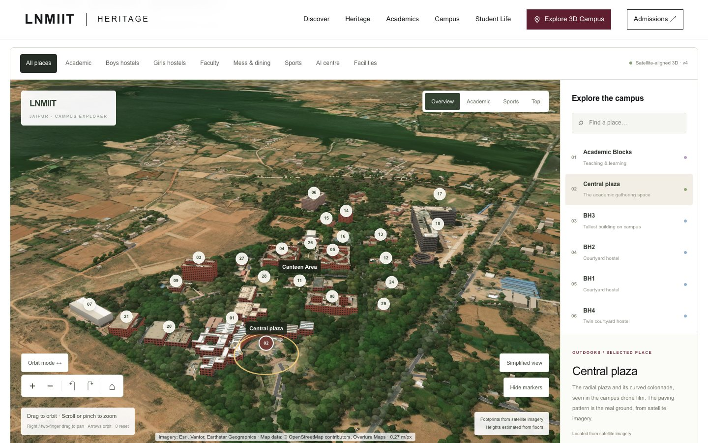 | **Major events** 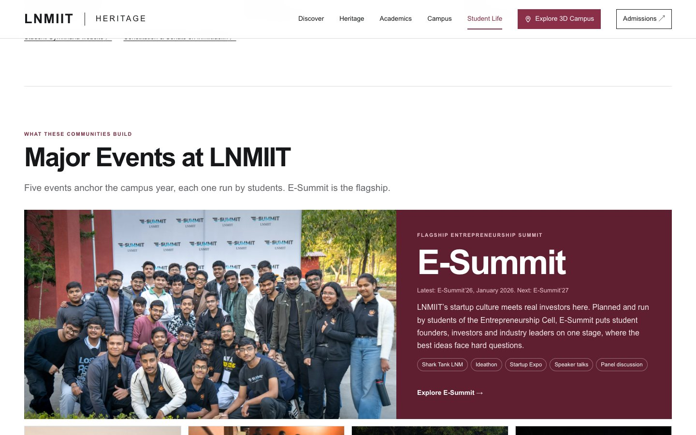 |
| **Student life** 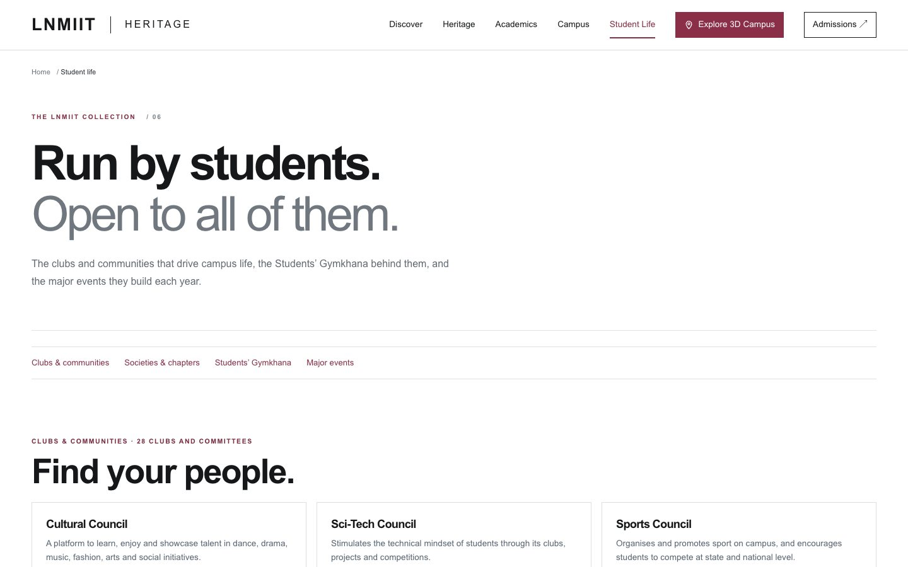 | **Clubs and communities** 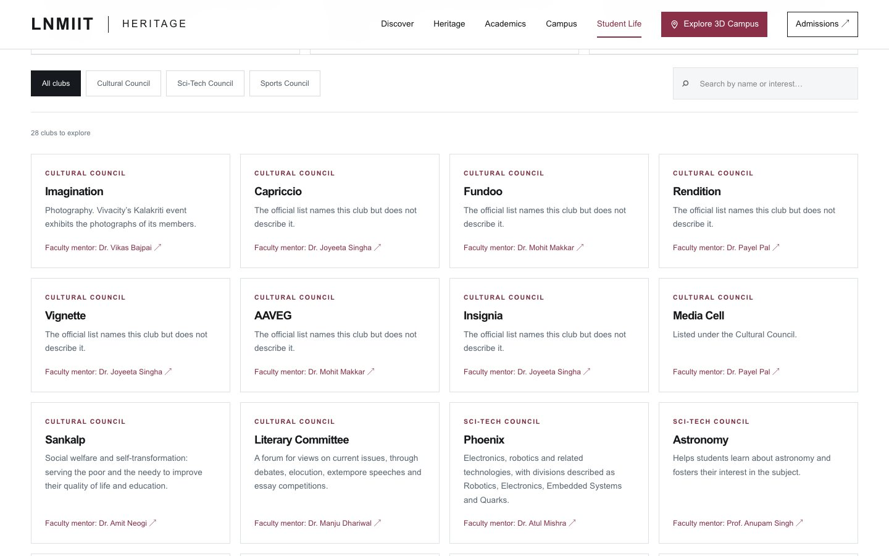 |
| **Event page** 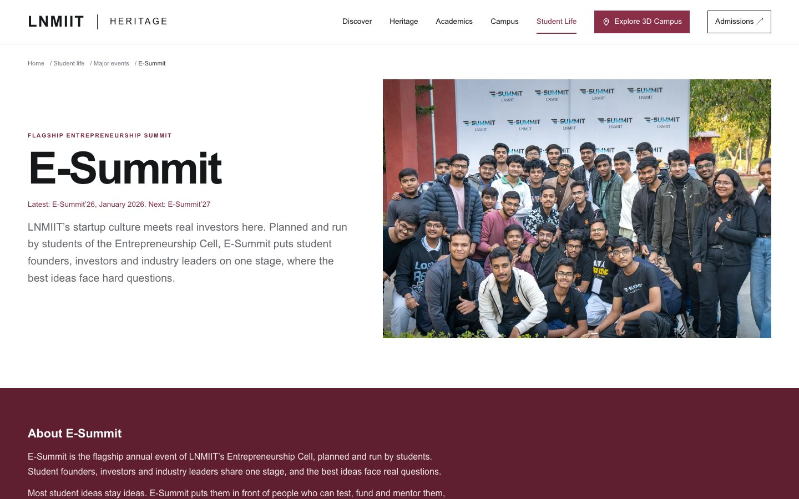 | **Academic departments** 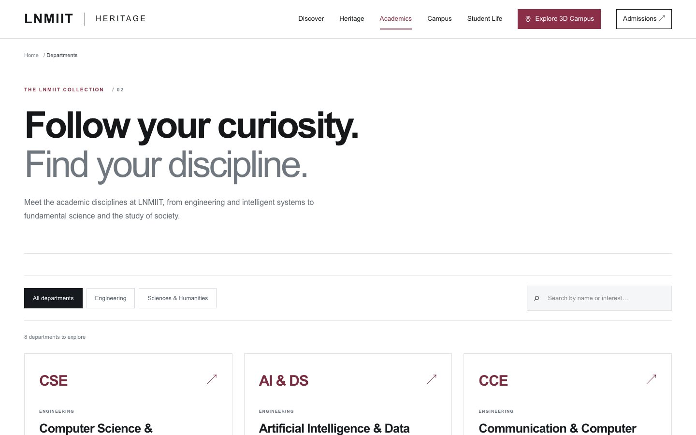 |
| **Heritage** 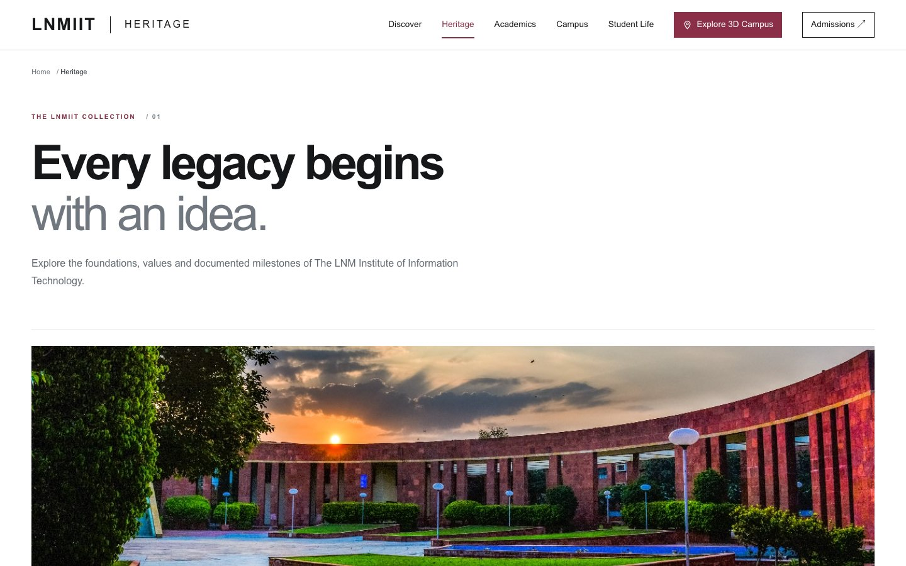 | **Gallery** 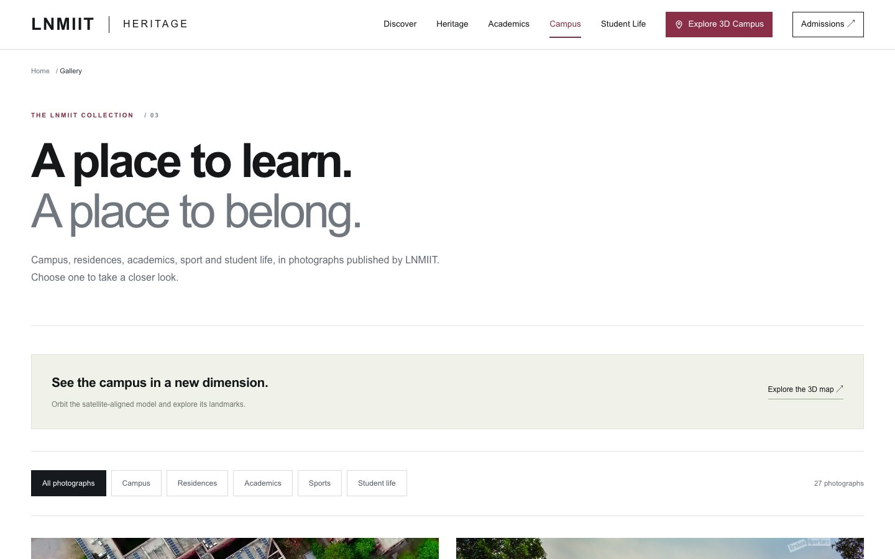 |
| **Admissions** 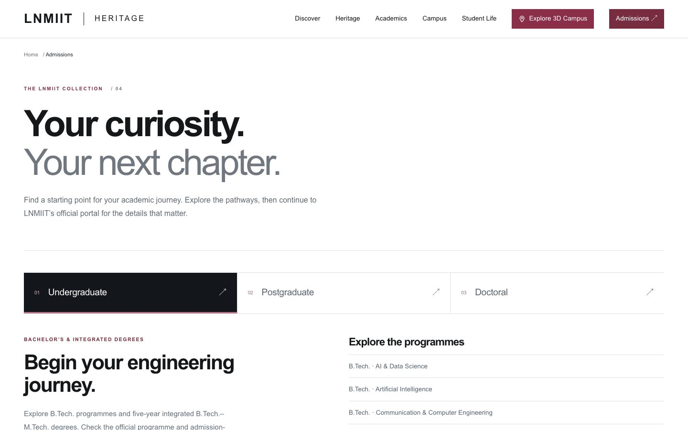 | **Phone layout** 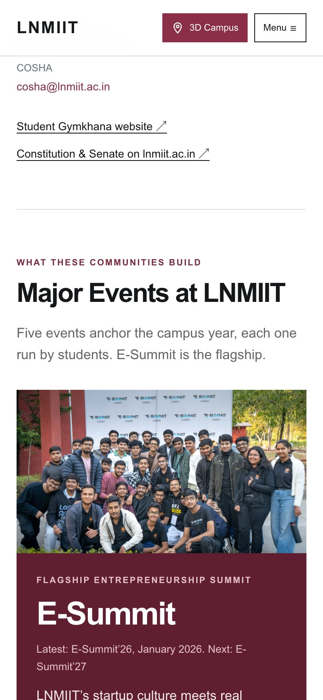 |

The map screenshot contains satellite imagery from Esri, Vantor, Earthstar Geographics and the GIS User Community, and map data from OpenStreetMap contributors and Overture Maps.

## Technology stack

| Layer | Technology |
| --- | --- |
| Framework | Next.js 16.3.1 (App Router) with static export |
| UI | React 19.2.8 |
| Language | JavaScript (ES modules). Python 3 for data and validation scripts only |
| 3D rendering | Three.js 0.186 (WebGL) |
| Styling | Tailwind CSS 4 entry point, with the site's styles hand-written in `src/app/globals.css` |
| Linting | ESLint 9 with `eslint-config-next` |
| Package manager | pnpm 11.25.0, with a committed lockfile |
| Runtime data service | Esri World Imagery tiles, streamed to the browser for the 3D map only. No key is needed |
| Backend, database, authentication | None |
| Hosting | None configured. The build output suits any static host |

## Architecture

The site is pre-rendered at build time into plain HTML, CSS, JavaScript and images in `out/`. Nothing runs on a server at request time. Content lives in JavaScript data files, and interactive components hydrate in the browser.

```text
src/data/*  ──▶  src/app/* pages  ──▶  next build  ──▶  out/ (static files)  ──▶  browser
                 src/components/*                                                   │
                                                 Esri satellite tiles (3D map only) ◀┘
```

```text
.
├── src/
│   ├── app/                 Routes, one folder per page, plus layout and global styles
│   │   ├── departments/[slug]/        Department detail pages
│   │   └── student-life/events/[slug]/ Major event pages
│   ├── components/          Shared UI and interactive client components
│   │   ├── CampusMap.js        3D map interface: filters, search, details
│   │   ├── CampusScene.js      Three.js scene, camera and rendering
│   │   ├── campus-imagery.js   Satellite tile loading and facade artwork
│   │   └── ClubExplorer.js     Club search and filters
│   └── data/                The content. Edit these files to change what the site says
│       ├── content.js          Departments, milestones, photographs, admissions
│       ├── student-life.js     Clubs, societies, Gymkhana, major events
│       ├── campus-model.mjs    The 28 named places
│       └── campus-real.mjs     Generated geometry. Do not edit by hand
├── public/media/            Photographs and images served by the site
├── scripts/                 Dev and static servers, validation and data generation
├── screenshots/             Images used in this README
├── original-media/          Source material kept for reference; not used at runtime
├── legacy/                  Files from the repository's first home page; not used by the site
├── docs/                    Architecture, setup, status and API notes, and the original SRS
├── SOURCES.md               Source and provenance record for all content
├── package.json             Scripts and dependencies
└── pnpm-lock.yaml           Exact dependency versions
```

More detail is in [docs/ARCHITECTURE.md](docs/ARCHITECTURE.md).

## Installation and setup

### Prerequisites

- **Node.js 22.13 or newer.** Node 22 LTS is recommended, and `.nvmrc` selects it for `nvm use`.
- **pnpm 11.25.0.** Install it with `npm install -g pnpm@11.25.0`.
- **Git.**
- **Python 3**, only for the optional `pnpm run check` export validator.
- **Internet access**, for dependency installation and for satellite imagery in the 3D map.

### Steps

This repository is private, so you need collaborator access to clone it.

```bash
git clone https://github.com/pxrth03/LNMIIT-Heritage-system.git
cd LNMIIT-Heritage-system
pnpm install --frozen-lockfile
pnpm run dev
```

Open <http://localhost:3000>. If port 3000 is in use, run `pnpm run dev --port 3001` and open <http://localhost:3001>.

There are no separate frontend and backend, so nothing else needs to be started. Environment, database and API configuration are not required.

### Production build

```bash
pnpm run build
pnpm start
```

`pnpm run build` writes the static site to `out/`, and `pnpm start` serves it at <http://localhost:3000> using the small Node server in `scripts/serve.mjs`. `next start` does not work with static export.

Troubleshooting is covered in [docs/SETUP.md](docs/SETUP.md).

## Environment variables

None are required. The one optional variable is documented in [.env.example](.env.example).

| Variable | Purpose | Required | Default | Where to set it |
| --- | --- | --- | --- | --- |
| `PORT` | Port for `pnpm start` | No | `3000` | In the shell, for example `PORT=4000 pnpm start`. `scripts/serve.mjs` does not read `.env` files |

No API keys, passwords or tokens are used. `.env` files are excluded from Git, except for the `.env.example` template.

## Database

This project has no database, collections, tables, migrations or seed data. All content is stored in `src/data/` and compiled into the static site.

## API

This project has no backend and exposes no API endpoints.

| Method | Endpoint | Purpose | Authentication |
| --- | --- | --- | --- |
| — | None | — | — |

The only runtime request to a data service is the browser fetching satellite tiles from Esri for the 3D map. See [docs/API.md](docs/API.md).

## Testing and verification

The project has no unit test framework and no `pnpm test` script. It has validation scripts instead.

| Command | What it checks | Current result |
| --- | --- | --- |
| `pnpm run check:campus` | Landmarks, routes and geometry, and the real scene setup against a stub renderer | Passes |
| `pnpm run build` | The production build | Passes |
| `pnpm run check` | Every exported page: routes, links, images, alt text, titles. Run after a build. Needs Python 3 (`python3`) | Passes, 23 pages |
| `pnpm run lint` | ESLint | **Fails: 2 existing errors and 14 warnings.** See [Known limitations](#known-limitations). This does not block the build |

To check the site by hand:

1. Open `/campus-map/`. The 3D scene should load, and choosing a place should fly the camera to it.
2. Open `/student-life/`. Search for "robotics" and confirm Phoenix appears, then filter by council.
3. Click each of the five major event cards and confirm that its page opens.
4. Narrow the browser to phone width and confirm that the menu works and nothing scrolls sideways.

There is no backend or database connectivity to verify. A fresh clone was tested on macOS with Node 22 and Node 26, but not on Windows or Linux. Details are in [docs/SETUP.md](docs/SETUP.md#what-has-been-tested).

## Known limitations

This is a prototype and is not ready for production. The full list is in [docs/PROJECT_STATUS.md](docs/PROJECT_STATUS.md). The main points are:

- **Lint:** `pnpm run lint` exits with 2 errors, at `src/components/NavBar.js:45` and `src/components/ParallaxTimeline.js:46`. The site works, and they are left unchanged so that this submission does not alter behaviour.
- **Unconfirmed content:** the homepage motto comes from Wikipedia and is not confirmed by LNMIIT. Eight clubs have no verified description. The fourth major event is shown as Desportivos pending confirmation (see [SOURCES.md](SOURCES.md)).
- **3D map:** it is an explorable model, not a survey or a navigation aid. Building heights are estimates and walls are representative artwork. Satellite imagery needs an internet connection.
- **Rights:** photographs belong to their rights holders. Permissions and imagery terms must be cleared before any public launch.

## Future scope

Not implemented: 360° tour, audio-guided tours, an AI campus assistant, accounts, a content management system, user uploads and automated tests. The original vision is in [docs/SRS.md](docs/SRS.md).

## Team, contributing and licence

**Team:** Yug Patel and Parth Vadalia. **Guide:** Dr Saurabh Kumar.

See [CONTRIBUTING.md](CONTRIBUTING.md) and [CHANGELOG.md](CHANGELOG.md).

**Licence:** none has been selected, so no permission to reuse, modify or redistribute this project is granted. Photographs, satellite imagery and map data remain the property of their respective owners, with credits on the `/sources/` page and in [SOURCES.md](SOURCES.md).
# LNMIIT-Heritage-System
